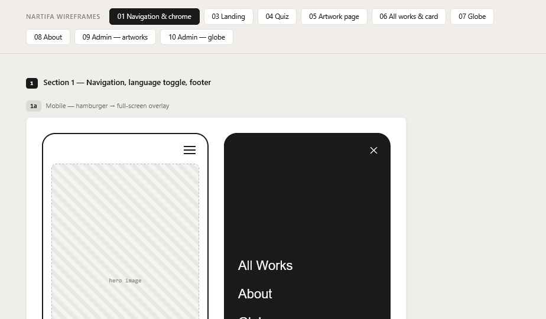

# 01 Navigation

Wireframes: **1a** (mobile), **1c** (desktop).

## Menu — Decided

The same pattern on every size: a menu icon that opens a full-screen overlay. The menu is always available but never competes with the artwork or quiz.

**Closed state**
- Top bar, height 56px. Left: "NARTIFA" wordmark (links to Landing). Right: menu icon (three lines).
- Bar sits over the page on the same `bg` color. No border.
- On desktop the bar is the same — no full link row (**1c**).

**Open state (1a)**
- Full-screen overlay, `bg` color, opens with a 250ms fade.
- Links, large (`title` size), stacked, left-aligned:
  1. Take the quiz
  2. All works
  3. Globe
  4. About
- Current page shown in `text`; others in `text-2`.
- Bottom of overlay: language toggle and Instagram link.
- ✕ replaces the menu icon in the same spot. Escape key and tapping a link also close it.
- Page behind does not scroll while open.

## Language toggle — Decided

- Text control: `EN / JA`. The current one in `text`, the other in `text-2`.
- Lives inside the menu overlay (bottom).
- Switching changes all interface text and all artwork content at once, and **stays on the same page and URL** (the URL has no language in it).
- The choice is remembered (cookie, 1 year) and wins over the browser language.
- Before a visitor uses the toggle: Japanese browsers see Japanese, all others see English (see 00).

## Footer — Decided

**No footer.** The Instagram link and language toggle live only in the menu overlay.

## During the quiz — Decided

The menu icon stays, same as every other page. See 04.

## States

| State | Behavior |
| --- | --- |
| Focus (keyboard) | 2px outline in `text`, offset 2px |
| Hover (desktop) | Link goes from `text-2` to `text`, 150ms |
