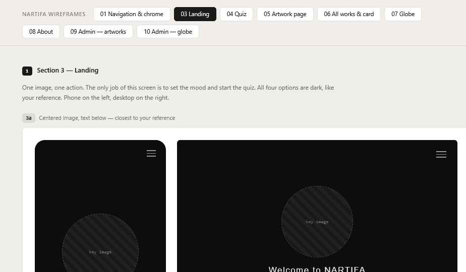

# 03 Landing

Wireframe: **3a** — Decided.

## Purpose

Set the mood and send the visitor into the quiz. One image, one line, one button. The visitor must understand: *answer a few questions → meet an artwork*.

## Layout — Decided (3a)

Top to bottom, centered, filling one screen (no scrolling on phones):

1. Top bar (see 01).
2. Artwork image, centered. Natural shape, no crop. Max height ~50% of the screen on mobile, ~60% on desktop.
3. One short line under the image, `display` size. Copy TBD by the artist; it should say what happens (e.g. "Six questions. One artwork.").
4. **Start** button.
5. Optional quiet link below: "or see all works" → All Works (Proposed).

## Start button

- Inverted: `text` fill, `bg` text, 4px radius, min 48px tall, min 160px wide.
- Hover: slight dim (90% opacity), 150ms.
- Goes to Quiz step 1.
- If no works are live yet (only before launch), the quiz shows one line: "No works yet."

## Image

- A separate file supplied by the artist — Decided. Use a placeholder until it arrives. Not managed in the admin; it is a static file in the code.
- Load it early; it is the first thing seen. Show `surface-2` in its place while loading, at the right shape.

## Responsive

| Mobile | Desktop |
| --- | --- |
| Image, text and button stacked, centered | Same, more space around. Do not switch to a split layout |

## Bilingual

The line under the image must fit two lines max in both languages at 375px width. The line lives in the interface text files (not the admin).
