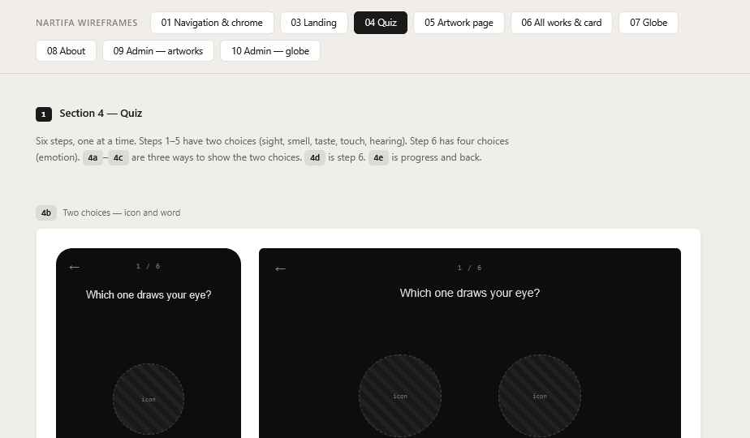

# 04 Quiz

Wireframes: **4b** (two choices), **4d** (emotions), **4e** (progress & back).

## Structure — Decided

Six steps, one per screen. One choice per step.

| Step | Sense | Option A | Option B |
| --- | --- | --- | --- |
| 1 | Sight | nature | industrial |
| 2 | Smell | wood | metal |
| 3 | Taste | sweet | spicy |
| 4 | Touch | smooth | rough |
| 5 | Hearing | bird | train |
| 6 | Feeling | joy · anger · sorrow · delight | |

- Steps 1–5 are **a choice between two words** (not a 1–5 scale) — Decided.
- Step 6 is **one** feeling (not multi-select) — Decided.
- Use these words for now — Decided. They live in the interface text files (EN/JA), not the admin, so changing a word is a small text edit. Artworks store "option A / option B", so changing a word never changes existing tags.
- The four feelings are fixed for now.

## Screen layout

Top to bottom:
1. Top bar with the **menu icon**, same as every page — Decided. Step counter below it.
2. Question, `display` size (e.g. "Which do you see?"). Copy TBD.
3. The choices, filling the middle of the screen.
4. Back control (from step 2 on).

## Steps 1–5 — icon + word (4b) — Decided

- Two equal tiles, side by side on all sizes.
- Each tile: an icon above a word. Icons ~48px. **The artist will draw them** — use blank placeholder squares for now.
- Tile: `surface` fill, no border, 4px radius, full height of the choice area (min 160px mobile).
- Whole tile is tappable.

## Step 6 — four feelings (4d) — Decided

- 2×2 grid on mobile, row of four on desktop.
- Same tile style, **icon + word** — Decided. The artist draws these icons too; placeholders for now.
- It is the last step — it can be a little larger, but keep the same visual language.

## Selecting — Decided

"Brief highlight, then advance":
1. Tap → tile inverts (`text` fill, `bg` text), 150ms.
2. Hold ~350ms so the visitor sees what they picked.
3. Move to next step (250ms fade/slide).

Ignore further taps during the hold so a double tap can't skip a step.

After step 6 → Artwork page in **reveal** state (see 05). Matching happens instantly in the browser, so there is no loading screen; the selected tile stays shown until the page appears.

## Progress and back (4e) — Decided

- Counter: "3 / 6" in `label` style.
- **Back is required.** "← Back" text link under the choices (or top left on desktop). Goes to the previous step with the earlier answer shown as selected; picking again replaces it.
- **Browser back (and iPhone swipe-back) does the same as Back.** Each step has its own history entry.
- Refreshing the page mid-quiz starts again at step 1.

## Leaving the quiz — Decided

Opening the menu mid-quiz and going to another page drops the answers. No confirm dialog.

## After the result — Decided

The result goes straight to that artwork's page (05).
- **Scoring:** one point for each of the five senses that match, plus one point if the feeling matches. Highest score wins.
- **No exact match:** show the closest work (highest score).
- **Ties:** if several works share the top score, one is picked at random. This means every work can be reached through the quiz; the same answers may give a different work on a retake.
- **Retake:** always from step 1 with fresh answers. A "Take the quiz again" link sits at the end of the artwork detail when arrived from the quiz.
- **Browser back from the result** returns to the quiz at step 1 with fresh answers.

(How the scoring can be changed later is in the build spec, 04 Matching.)

## States

| State | Behavior |
| --- | --- |
| Hover (desktop) | Tile `surface` → `surface-2` |
| Focus | 2px `text` outline; arrow keys move between tiles, Enter selects |
| Previously answered (after Back) | Tile shown inverted |
| Reduced motion | No slide; instant change |
| No works live (before launch) | One line: "No works yet." |

## Bilingual

Words are short but check: the longest JA and EN word must fit one line in a tile at 375px (tile ≈ 160px wide).
