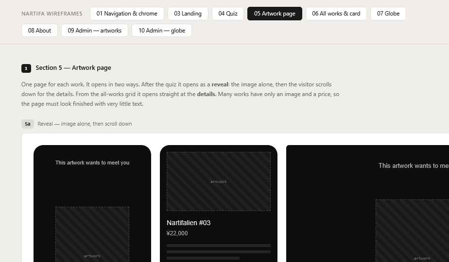

# 05 Artwork Page

Wireframes: **5a** (reveal), **5b** (detail, desktop), **5d** (missing fields), **5e** (extra images).

One page and one URL per artwork (`/works/{id}`). It opens in one of two states depending on how the visitor arrived.

| Arrived from | State |
| --- | --- |
| Quiz | Reveal, then detail below |
| All Works, shared link, refresh, anywhere else | Detail only |

A link copied from the reveal screen opens in the detail state for whoever receives it.

## Reveal state (5a) — Decided

- Full screen, `bg`.
- Short line at the top, `small`, `text-2`: "This artwork wants to meet you" (copy TBD).
- The artwork, centered, natural shape, as large as fits with margin. Fades in over 600ms after a short pause (~300ms).
- A **down arrow** at the bottom center. Tap or scroll → smooth scroll to the detail.
- No price, title or other data on this screen.
- No footer. Top bar shown (menu returns after the quiz).

## Detail state

**Mobile:** image on top (full width, natural shape), then text below.
**Desktop (5b):** image left (~60%), text right (~40%), text column sticks while the image side scrolls if there are extra images.

Text, in this order, each only if it has a value:
1. Title — `title`
2. Price — `small`, `text-2`. "¥22,000" or "Price on request" (empty price = on request)
3. Description — `body`, max 640px wide
4. Details list: size, materials, medium, year — `small`, label in `text-3`, value in `text-2`
5. **Ask about this work** — quiet text link with arrow (Decided). Opens an Instagram DM to the artist. New tab on desktop. Whether the message can be pre-filled with the work's name is **to be confirmed in the build**; if Instagram doesn't allow it, the link opens the DM empty, or copies a short message first and shows "Message copied".

Below: "← All works" link. If arrived from the quiz, also "Take the quiz again". No footer.

## Missing fields (5d) — Decided

- Empty fields are not rendered. No labels, no gaps.
- Image + price only must still look finished: the text column just gets shorter. On desktop, center the short text column vertically against the image.
- If English is missing, show the Japanese — Decided. Many works will have Japanese text only, so an English page will often show Japanese title and description. Japanese text keeps its 1.8 line height.
- The inquiry link always shows.

## Extra images (5e) — Decided

- One image: no gallery controls at all.
- 2+ images: a row of small thumbnails under the main image, on both mobile and desktop. The current one has a light border. Tapping a thumbnail swaps the main image.
- Desktop: main image left, thumbnails under it, text right (as 5b).
- Tapping the main image opens it full screen on `surface`, with ✕. Swipe between images on mobile (Proposed).

## States

| State | Behavior |
| --- | --- |
| Image loading | `surface-2` block at the image's shape (width/height are stored, so the shape is known) |
| Work hidden, incomplete, deleted or unknown | "This work is no longer available" with a link to All Works (HTTP 404, same for every case) |
| Reduced motion | Reveal image appears without the fade; arrow tap jumps instead of scrolling smoothly |

## Sharing — Decided

- Page title = artwork title (or "NARTIFA" if none).
- Social preview image = the artwork, fitted inside the preview frame on `bg` (never cropped).
- Previews are in Japanese (link previews have no language set).

## Image alt text — Decided

Generated, not typed by the artist: the artwork title, or "Artwork by NARTIFA" if there is none.
