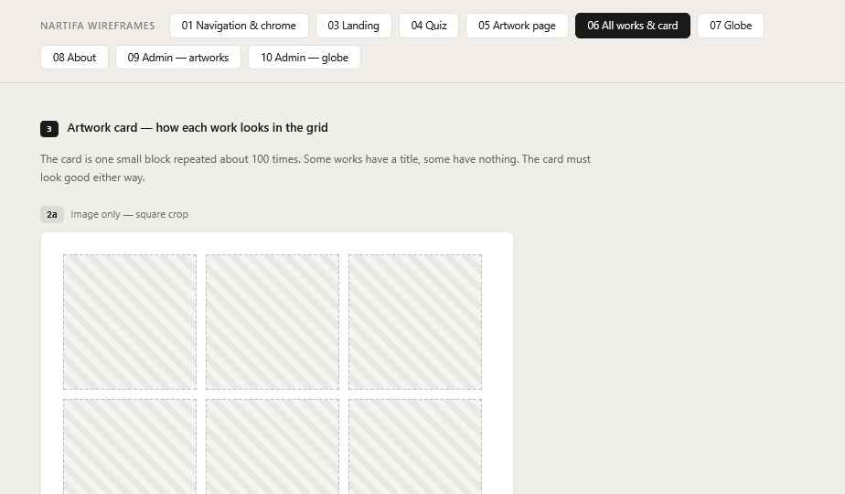

# 06 All Works

Wireframes: **2b** (card), **6a** (grid), **6c** (spacing).

## Flow — Decided

Menu → All Works → grid. **For now the page goes straight to the grid.**

### Collection graphic — paused

Later, a graphic will appear before the grid, with parts that open different collections. The artist will make it; it is not needed now. The data is built now so it is ready:
- Collections are added by the artist in the admin (see 09).
- A work can be in **more than one** collection.
- Collections are not shown on the public site in v1.

## Grid

- Order: **newest first** (by date added to the site) — Decided. Easy to change later.
- Loading: **infinite scroll** — Decided. Load 24 works at a time, start loading the next set before the visitor reaches the bottom.
- Columns: 2 mobile, 3 tablet, 4 desktop.
- Gap: see **6c** — Proposed 12px mobile, 24px desktop.
- Shape: **even grid, square crop** (6a) — Decided for now. Every card is the same square; the full image is seen on the artwork page.
- Only **live** works appear.

## Card — Decided (2b)

Image + title below. Title in `small`, `text-2`, one line, ellipsis if too long. If a work has no title, the title line is simply not shown — the grid must still line up (Proposed: keep row height by aligning images to the top). Title falls back to Japanese if English is missing.

Tap → Artwork page, detail state.
Hover (desktop): image dims to 85%, 150ms.

## States

| State | Behavior |
| --- | --- |
| First load | Placeholder blocks in `surface-2`, in the grid shape |
| Loading more | 2–4 placeholder blocks at the bottom |
| End of list | Nothing extra |
| Few works (< 8) | Same grid, no stretching. Grid stays left-aligned |
| Load error | One line + "Try again" link |

**Keep scroll position when coming back from an artwork page** — Decided. The works already loaded and the scroll position are restored.
