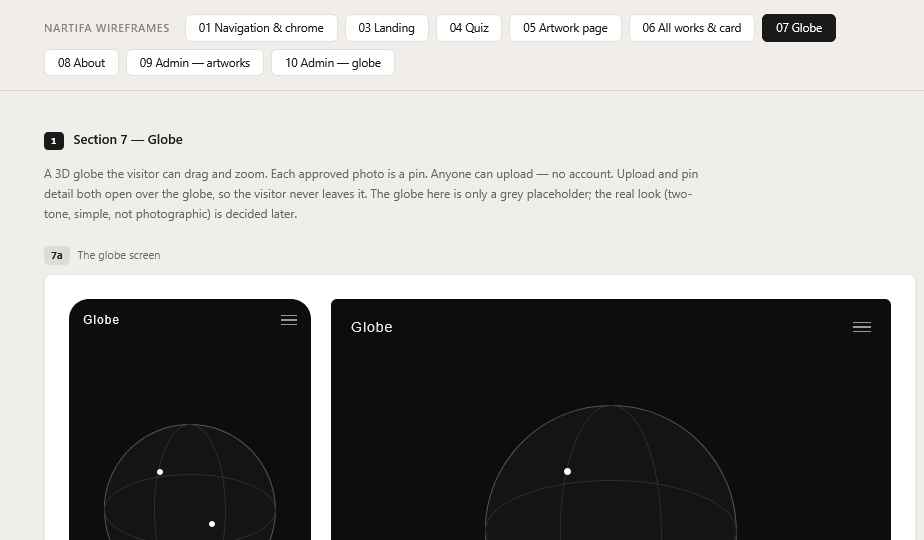

# 07 Globe

Wireframes: **7a** (globe), **7b** (pins), **7c** (photo view), **7d** (upload), **7e** (thank you), **7f** (look references).

Visitors share photos where nature and the man-made exist together. Each approved photo is a pin on a 3D globe. No account needed; every upload is checked by the artist first.

## Globe screen (7a) — Decided

- Full screen, `bg`. Top bar over it.
- Globe centered, ~90% of screen width on mobile.
- Two-tone, low detail: solid dark sphere, light land outlines or fills. Not photographic. See **7f** for references; exact look to confirm with the artist. (In the build, the land is one pre-drawn image, so changing the look later is easy.)
- Drag to rotate, pinch/scroll to zoom. No sliding the globe sideways. Slow auto-rotate until first touch (Proposed); off with reduced motion.
- One short line + **Share a photo** button at the bottom.

## Pins (7b) — Decided

- **For now:** plain white dots (`pin`), ~6px, with a 44px invisible tap area.
- **Later:** a custom pin image drawn by the artist. Brief for the artist: a simple shape that reads at 16–24px, square transparent PNG at 128×128. He also chooses whether it always faces the viewer or lies flat on the globe's surface. Pins will be larger than the dots, so check crowding when it arrives.
- No photos on the globe itself.
- Show all pins for now. **Grouping will be added later** — Decided.
- Since locations are city-level, many pins share one spot. They are spread in a small spiral around the city. Fully zoomed out, same-city pins still overlap and a tap opens the nearest; zooming in separates them.

## Photo view (7c) — Decided

Tapping a pin opens the photo almost full screen.
- `surface` background over the globe, 250ms fade.
- Photo, as large as fits, natural shape. Loads only when the pin is tapped.
- Below: place name (`small`, `text`) and comment if any (`small`, `text-2`). Place name in the visitor's language (e.g. "Osaka, Japan" / "大阪, 日本").
- ✕ top right. Closing returns to the globe where the visitor left it.
- Desktop: same, centered, photo max ~70% of screen height.

## Upload (7d) — Decided

Opens over the globe: bottom sheet on mobile, side panel on desktop.

Content, top to bottom:
1. Short explanation of what to share (copy TBD by the artist).
2. **Photo** — required, one photo. Tap to choose or take a photo. Shows a preview after choosing. JPG, PNG or WebP.
3. **Place** — required. **Typed city name with suggestions.** Visitor types a city and picks from the list (free text not accepted). City level only for now; more precise locations may come later.
   - **Suggested from the photo:** if the photo carries location data, the nearest city is filled in automatically with a small note "Suggested from your photo." The visitor can change it. Only the city is ever kept or shown — the exact location never leaves the visitor's phone. Many photos carry no location (phones and the Instagram browser often remove it); then the field is simply empty.
4. **Comment** — optional, max 140 characters, counter shown near the limit.
5. Spam check — usually invisible. Leave room under the Send button for a small checkbox that some visitors will see.
6. **Send** button, disabled until photo and place are filled.

Before sending, the photo is resized on the visitor's phone (max 2400px) and all hidden photo data is removed.

## Thank you (7e) — Decided

- Replaces the form in the same sheet/panel.
- "Thank you. Your photo will appear after it is checked." (copy TBD)
- One button: back to the globe.
- The visitor does **not** see their own pin.

## Limits — Decided

| Limit | Value | Message |
| --- | --- | --- |
| Photos per upload | 1 | — |
| File type | JPG, PNG, WebP (iPhones convert HEIC automatically) | "Please use JPG or PNG" |
| File size | 5MB after resizing (rarely reached) | Error under the field |
| Uploads per visitor | 5 per hour, 20 per day | Error line above Send |
| Waiting for review | If 400 or more are waiting, new uploads pause | "Please try again later" |

## States

| State | Behavior |
| --- | --- |
| Globe loading | Dark circle outline, then fade the globe in |
| Device too weak / WebGL off | Simple flat message and the Share button |
| Photo wrong type / too large | Error under the field in `error` color |
| Place not found | "Try a nearby city" under the field |
| Photo has location data | Place pre-filled, "Suggested from your photo" |
| Sending | Button shows "Sending…" and is disabled |
| Send failed / limit reached | Error line, form stays filled |
| New pin after approval | Appears on the globe within about a minute |

## Credit

City names come from GeoNames. The credit line sits at the bottom of About (see 08).

## Performance

The globe is the heaviest part of the site and loads only on this page. Keep it light on phones: low-detail globe, pins as one batched object, photos loaded only when a pin is tapped.
