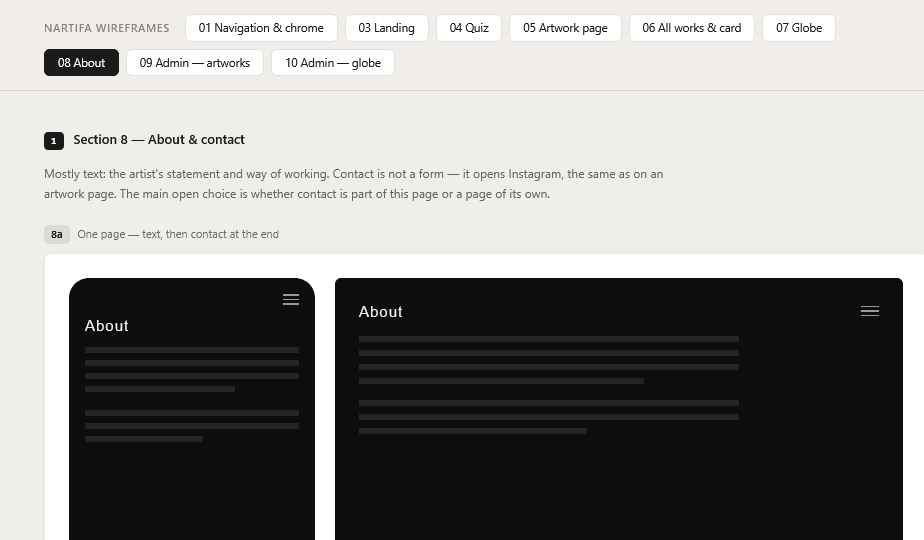

# 08 About

Wireframes: **8a** (text, contact at end), **8b** (with photo), **8c** (separate contact page), **8d** (JA length check).

## Layout — Decided

**One page** (8a), with an optional photo (8b) if the artist provides one.

Top to bottom:
1. Top bar.
2. Page title "About", `title`.
3. Photo, if present — full text width, natural shape.
4. Text — `body`, max 640px, left-aligned. Paragraphs separated by 24px.
5. Contact: one short line and a **Message on Instagram** link (opens DM, new tab on desktop).
6. Bottom line, `label` size, `text-3`: a **Privacy** link to `/privacy` (11), then the credit "City data © GeoNames (CC BY 4.0)". The credit is required by the city list's licence.

No separate Contact page. The menu "About" item covers both.

## Content — Decided

- Written by the artist in both languages, **kept as fixed text in the code** (the interface text files), not in the admin. Changes go through Steffan.
- Simple formatting only: paragraphs, and maybe links.

## Bilingual (8d)

Japanese text will be a different length. Check with real text in both languages that:
- line length stays comfortable (≤ 640px),
- JA uses 1.8 line height,
- the contact link stays visible at the end.

## States

| State | Behavior |
| --- | --- |
| No photo | Text moves up, no empty space |
| Text missing in current language | Show Japanese |
