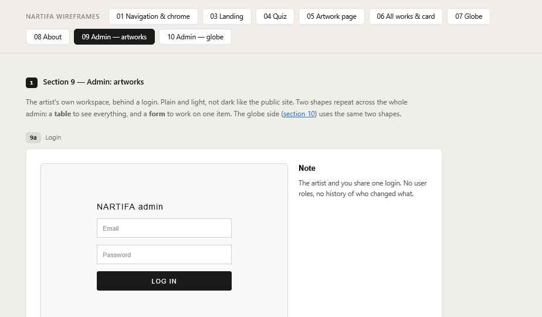

# 09 Admin — Artworks

Wireframes: **9a** (login), **9b** (table), **9c** (edit form), **9d** (new form). **9e** (1–5 scale) is not used — the quiz stays a two-word choice.

The artist's tool for adding and editing works. Light, plain UI (see admin colors in *00 Tokens.md*). Built on the CMS (Payload), so follow its patterns where they fit.

## General — Decided

- `/admin` opens on the **artworks table**.
- Admin menu: Artworks · Review queue (with the waiting count) · Submissions · Collections.
- Admin language switchable between English and Japanese. Every field label exists in both.

## Login (9a) — Decided

- One account per person (Steffan, the artist). Email + password, **Log in** button. Nothing else — no "forgot password". Steffan resets passwords if needed (docs/Admin Accounts.md).
- Wrong details: one error line under the form.

## Artworks table (9b) — Decided

Toolbar: search (title, EN or JA) · status filter as simple buttons (All / Live / Hidden / Incomplete) · column picker · **New artwork** button.

| Column | Notes |
| --- | --- |
| Thumbnail | 40×40, cropped square |
| Title | JA, else EN |
| Price | "¥22,000" / "On request" |
| Status | Live / Hidden / **Incomplete** — with the reason |
| Updated | Relative date |
| ⋯ menu | Edit · Hide/Show · Delete |

- **Incomplete** must say what's missing (e.g. "Incomplete: needs Smell, Feeling") so it isn't confused with manually hidden.
- Click a row → edit form.
- Delete asks for confirmation. Deleted works **cannot be recovered** — say so in the confirm step.
- Deleting an image is always allowed. A work that used it as its main image goes to **Incomplete** ("needs Main image") and comes off the site; its Live switch stays on, so choosing a new main image puts it back. Two works sharing a main image is expected to be rare.

## Artwork form (9c edit, 9d new)

**Layout — Proposed: start with the CMS's own layout.** A main column plus a narrow side column, styled to look clean:
- **Side column:** Live toggle · status note · Collections · Save.
- **Main column, in sections:**
  1. Images — main image, extra images (drag to reorder)
  2. Matching — the six selects
  3. Content — the text fields

This is reviewed once real fields are in. If it doesn't look good, the form switches to the 9c layout (images left, fields right). The fields and rules below stay the same either way.

**Matching — all six needed to go live**
- Sight, Smell, Taste, Touch, Hearing: a select each, two options (e.g. *nature / industrial*), same words as the quiz.
- Feeling: one select, four options.

**Content** (all optional)
- Title EN · Title JA (a work can go live with only one language)
- Description EN · Description JA
- Price (JPY number). Empty = "Price on request" on the site — no separate option.
- Size — **one value**, same in both languages
- Materials EN · Materials JA
- Medium EN · Medium JA
- Year
- **Collections** — pick one or more. The artist can **add new collections** from the picker; a new collection needs **both** a Japanese and an English name. Needed later for the collection graphic in 06.

No alt text field — image descriptions are generated from the title.

## Validation

| Rule | Behavior |
| --- | --- |
| Live on but tags missing | Save allowed; status becomes **Incomplete**, a note shows "Not live — missing: Smell, Feeling" |
| No main image | Same as above — **six tags + main image** are required to go live (Decided for now, easy to change) |
| Price | Whole number, no symbol. Shown as ¥ with commas |
| Year | 4 digits |
| Image | JPG/PNG/WebP, max 20MB (Proposed). Width and height stored automatically |

## States

| State | Behavior |
| --- | --- |
| Unsaved changes | Save button active; warn before leaving |
| Saving | "Saving…" |
| Saved | Short "Saved" message, 2s |
| Empty table | "No artworks yet" + New artwork button |

Changes appear on the public site immediately after saving.
