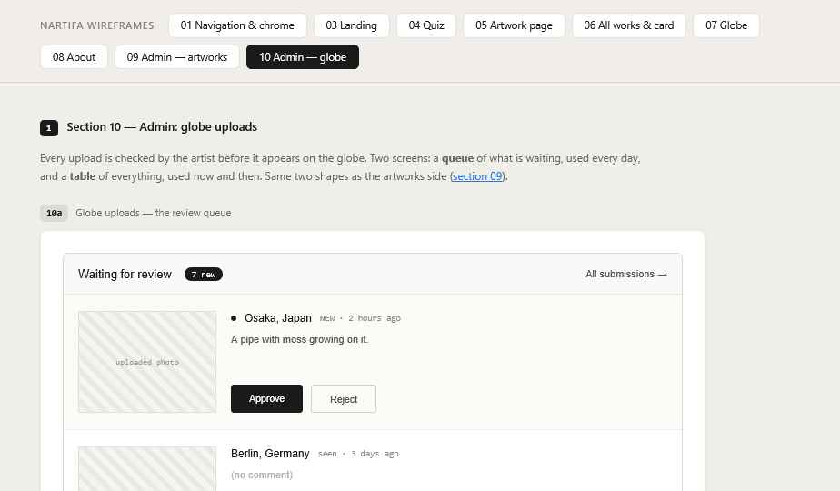

# 10 Admin — Globe uploads

Wireframes: **10a** (review queue), **10b** (all submissions), **10c** (edit). All Decided.

Same visual style and table pattern as 09.

## Review queue (10a)

The daily tool: open it, clear what's new. Built for the computer first; rows stack on narrow screens so it still works on a phone.

- Header: "Waiting for review" + count badge · link to All submissions.
- **Badge = everything waiting for a decision** (all pending uploads), not only the new ones.
- **Newest first.**
- One row per upload: photo (150×110), place, time sent, comment (or "(no comment)"), **Approve** and **Reject** buttons.
- **New** uploads (not yet seen) have a dot before the place name. The dot goes away once the row has been on screen for about a second.
- Approve → becomes a live pin (on the globe within about a minute). Reject → moved to a separate **Rejected** area (kept, not shown). Nobody is notified (uploads are anonymous).
- The decision is saved immediately and the row disappears. A 5-second "Undo" message reverses it. Closing the page never loses a decision.
- Click the photo → larger view.
- The waiting count also shows next to "Review queue" in the admin menu.

## All submissions (10b)

Same toolbar as the artworks table: search (place or comment) · status filter as buttons (All / Pending / Live / Hidden / Rejected) · column picker.

"All" does not include Rejected. Rejected uploads only show when the filter is set to Rejected. From there they can be restored to Pending or deleted for good.

| Column | Notes |
| --- | --- |
| Thumbnail | 30×30 |
| Place | |
| Comment | One line, cut off |
| Status | Pending / Live / Hidden / Rejected |
| Sent | Date |
| ⋯ menu | Edit · Hide/Show · Delete |

## Edit upload (10c)

Same layout approach as the artwork form (CMS layout first, see 09).
- Header: "← All submissions" · **Status** (Pending / Live / Hidden / Rejected) · **Save**.
- Photo, "sent 2 hours ago".
- City — changed by searching the same city list as the upload form.
- Coordinates — read-only; they always come from the city.
- Comment.
- "Delete this upload" in `danger` color, with confirmation.

Pending, hidden and rejected photos are never visible on the public site, even by direct link.

## States

| State | Behavior |
| --- | --- |
| Queue empty | "Nothing to review." |
| New uploads | No email alerts for now — the artist checks the queue |
| Action failed | Row stays, error line in the row |
| Very full queue | At 400 waiting, the public upload form pauses until the queue is reduced |
